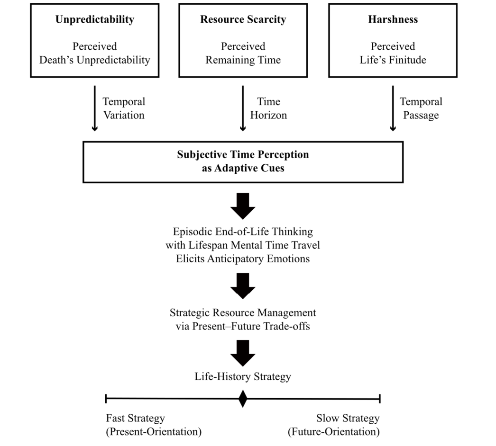
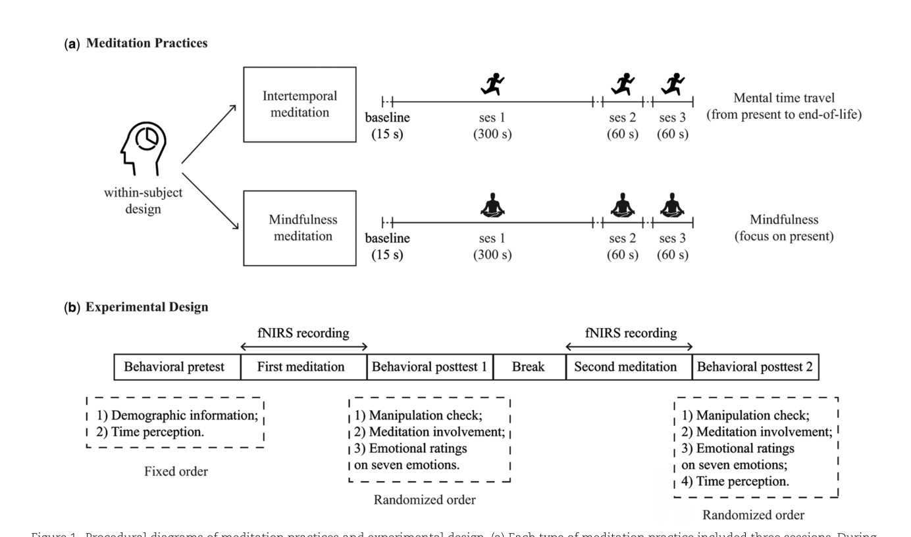
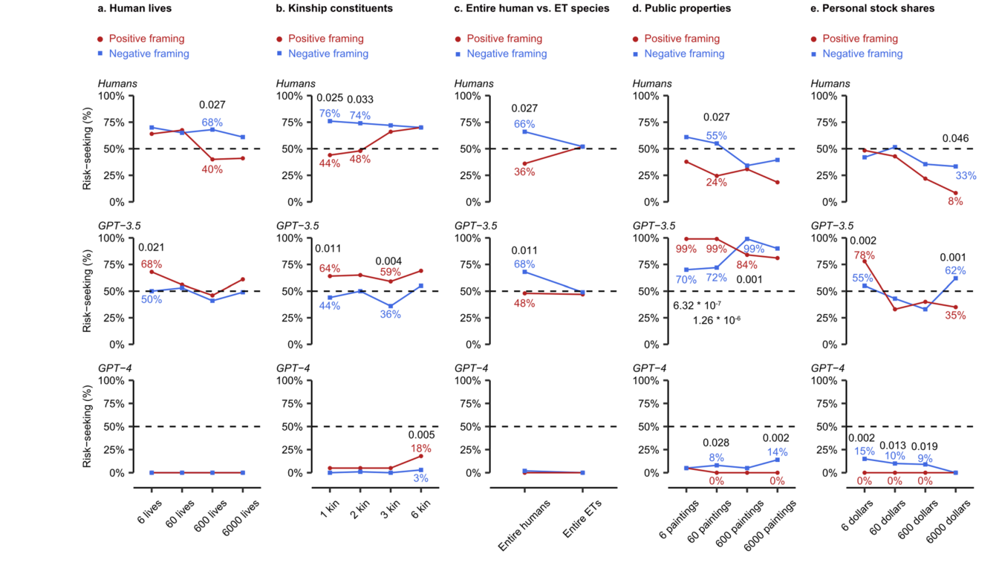

---
title: "Research"
---

## The Question Behind My Research

**How do human and artificial agents make decisions—and why do they decide differently?**

My research approaches behavioral decision-making from two complementary perspectives: **proximate psychological and neural mechanisms** and **evolutionary explanations** of human behavior. Two lines of work currently bring these questions together.

---

## 01 · Autonoetic Consciousness, Mental Time Travel, and Decision-Making

Humans can mentally revisit the past and imagine their own futures—a capacity known as **autonoetic consciousness**. It allows us to construct autobiographical narratives about our lives, including where our life stories may lead. I study how this form of **self-storytelling** shapes our sense of time, emotions, and decisions.

### A Theory of Adaptive Time Management

Our **adaptive time management** framework proposes that awareness of life's limited time can help people adjust their priorities and balance present needs with future goals. Rather than viewing mortality awareness only as a source of fear, we examine its potential adaptive functions.

{width="82%" fig-align="center"}

[Read the theoretical framework](https://doi.org/10.70322/ldmh.2025.10017)

### Testing Competing Explanations

We compared **adaptive time management** with **terror management theory**, using behavioral decisions and fNIRS to examine how reflection on life's endpoint changes time perception and present–future trade-offs. The findings offer evidence for a strategic time-management account, beyond an explanation based solely on fear and defense.

[Read the study in *Acta Psychologica*](https://doi.org/10.1016/j.actpsy.2026.107147)

### From Theory to Practice: Intertemporal Meditation

We developed **intertemporal meditation**, combining mindfulness with mental time travel across one's life. Our studies suggest that reflecting on life's passage can alter subjective time and emotional experience, with implications for adaptive decision-making.

{width="88%" fig-align="center"}

[Neuroscience study — *SCAN*](https://doi.org/10.1093/scan/nsaf080) · [Behavioral study — *Mindfulness*](https://doi.org/10.1007/s12671-026-02959-8)

---

## 02 · Human and Artificial Intelligence in Decision-Making

Can large language models reproduce **how humans adapt their decisions to social situations**—not just predict which option people choose?

In our published work, we compared human decisions with predictions from GPT models across diverse social and financial situations. We found important differences: human choices were especially sensitive to social cues such as **kinship and group size**, while the models often responded differently.

{width="100%" fig-align="center"}

[Read the study in *Scientific Reports*](https://doi.org/10.1038/s41598-025-17188-7)

### Ongoing Research: Beyond Behavioral Similarity

My current work examines **functional alignment**: whether AI agents change their choices in human-like ways *when the context changes*. I am also interested in whether successive generations of language models move toward **human adaptive patterns** or toward more rigid, extreme responses.

The goal is not simply to measure AI performance, but to use human–AI differences to better understand **the distinctive features of human decision-making**.

